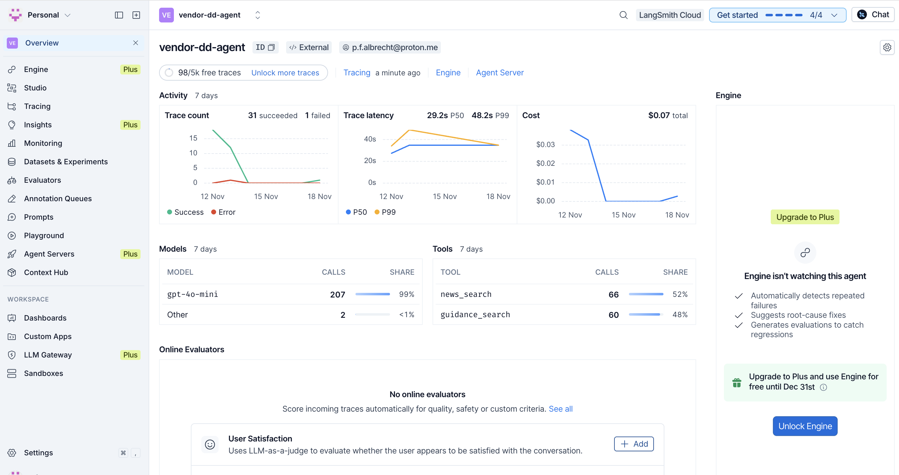

# Lab proof: Defend your stack's carbon story (Path B)

**Path followed:** Path B, green retrofit audit
**Artifact audited:** Project 3, Vendor Due-Diligence Agent: https://github.com/PietFALB/vendor-dd-agent
**Functional unit (R):** one completed vendor due-diligence risk report
**Primary audience:** Head of Compliance at a mid-size Dutch law firm

## 1. Code / workflow

The system being audited (not changed in this lab):

- Agent graph: [`agent/graph.py`](https://github.com/PietFALB/vendor-dd-agent/blob/main/agent/graph.py)
- Research agent with its tool budget: [`agent/review.py`](https://github.com/PietFALB/vendor-dd-agent/blob/main/agent/review.py) (`MAX_SEARCHES = 6`, `MAX_STEPS = 20`)
- GLEIF entity resolution (the 12 exact-name searches): [`tools/gleif.py`](https://github.com/PietFALB/vendor-dd-agent/blob/main/tools/gleif.py)
- n8n workflow export: [`n8n/vendor_dd_workflow.json`](https://github.com/PietFALB/vendor-dd-agent/blob/main/n8n/vendor_dd_workflow.json)

The code that built this lab's deck: [`source/build_deck.js`](source/build_deck.js) (pptxgenjs).

## 2. One run, with its input

- **Input:** company name `Sberbank` (no KvK number)
- **Command:** `python main.py "Sberbank"`
- **Date:** 18 November 2026, traced in LangSmith (project `vendor-dd-agent`)
- **Route taken:** enhanced review (strong sanctions hit)

## 3. Evidence it produced

| Measure | Value | Source |
|---|---|---|
| Tokens for this one report | **17.61k** | LangSmith run panel for the Sberbank trace |
| LLM calls (7 days) | 207 gpt-4o-mini calls over 32 traces, so about 6.5 per report | [`images/langsmith_overview_7days.png`](images/langsmith_overview_7days.png) |
| Agent tool calls (7 days) | 66 `news_search` + 60 `guidance_search` (48% guidance) | same screenshot |
| Latency | P50 29.2 s, P99 48.2 s | same screenshot |
| Cost (7 days) | $0.07 total, so about $0.002 per report | same screenshot |

The repeated work found in the code (caching candidates) is listed with file references in [`retrofit_audit.md`](retrofit_audit.md).

## 4. Final output

- **Deck (13 content slides + title):** [`deck/carbon_story_vendor_dd_agent_path_b.pptx`](deck/carbon_story_vendor_dd_agent_path_b.pptx) · PDF: [`deck/carbon_story_vendor_dd_agent_path_b.pdf`](deck/carbon_story_vendor_dd_agent_path_b.pdf)
- **Retrofit audit template, filled in:** [`retrofit_audit.md`](retrofit_audit.md)
- **The report the run produced (R itself):** sample in the project repo: [`reports/final_Sberbank_2026-11-11.md`](https://github.com/PietFALB/vendor-dd-agent/blob/main/reports/final_Sberbank_2026-11-11.md)

Main finding: almost half of the research agent's tool calls go to a fixed guidance corpus. Moving that retrieval out of the agent loop and caching it should cut about 45% of tool calls and about 30% of tokens per report (a hypothesis, to be measured for one week).

## 5. Failure / limitation I hit

- **Per-report numbers are partly averaged.** LangSmith's overview counts every trace, including debug and test runs (for example `tests/debug_review.py`), and one of the 32 traces failed. So "6.5 LLM calls per report" is approximate. Only the 17.61k tokens figure comes from a single, known report. Fix: tag production runs in LangSmith so they can be filtered.
- **Cost is a poor stand-in for energy here.** At about $0.002 per report the cost signal is too small to show improvements, so the measurement plan uses tokens and calls per R instead.
- **Provider regions are unconfirmed** (OpenAI, Tavily, Pinecone free tier), so grid intensity (I) and a real SCI score cannot be calculated yet. The deck says so instead of claiming a carbon figure.
